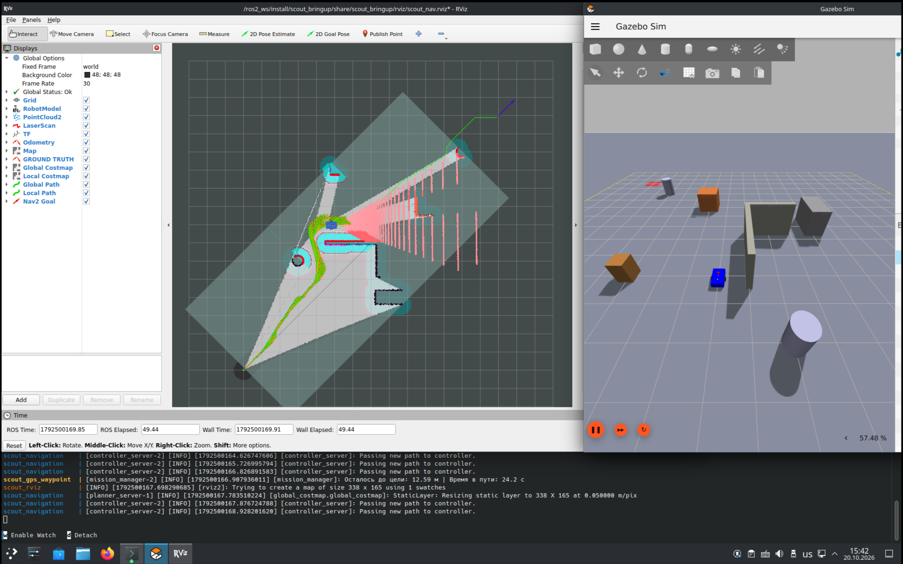
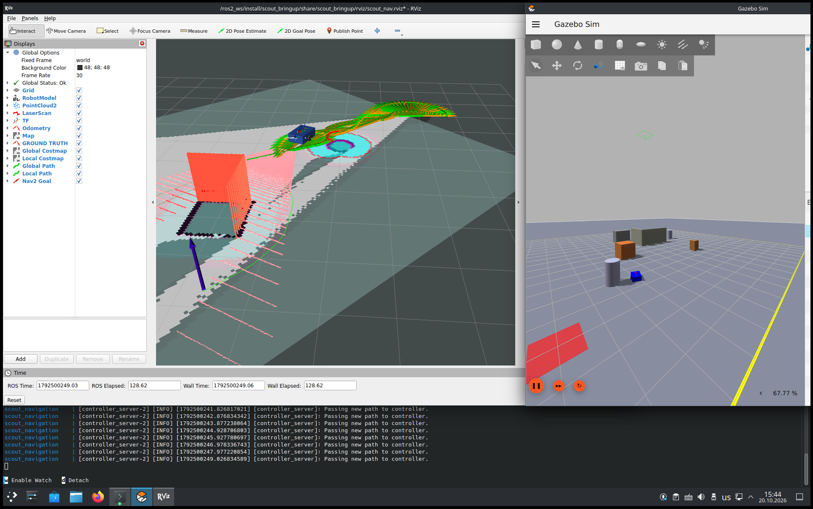

# 🤖 Autonomous Robot Scout Mini

**Автономный мобильный робот: симуляция в Gazebo Harmonic + навигационный стек ROS 2 Jazzy в Docker**

[](https://docs.ros.org/en/jazzy/)
[](https://gazebosim.org/docs/harmonic/)
[](https://ubuntu.com/)
[](https://docs.docker.com/compose/)
[](LICENSE)

---

🇷🇺 [Русский]

## Описание

**Scout Mini** — тестовый проект автономного мобильного робота в симуляции
Gazebo Harmonic. Робот полностью самостоятельно проезжает из точки А в точку Б
по GPS-координатам, строя карту (SLAM) и объезжая препятствия по данным LiDAR,
камеры глубины и IMU. Вмешательство человека не требуется: запуск — одна команда.

### Цели первого этапа

- ✅ Архитектура микросервисов: 7 контейнеров Docker Compose
- ✅ Симуляция с физикой, сенсорами и GPS-привязкой
- ✅ Локализация: EKF (robot_localization) + SLAM Toolbox
- ✅ Навигация: Nav2 (SmacPlanner2D + RegulatedPurePursuit)
- ✅ Автономная GPS-миссия A→B на C++ нодах
- ✅ Запись миссий в rosbag (MCAP+zstd) и воспроизведение
- ✅ Воспроизводимость: git clone → 2 команды → робот едет

## Архитектура
```text
[1] gz_sim ──► [2] robot_state ──► [3] slam ──► [4] navigation ──► робот едет
   Gazebo         EKF + NavSat         карта       Smac + RPP
                       ▲                              ▲
                       └── [5] gps_waypoint (миссия) ─┘
                            ждёт Nav2 + RViz

[6] rviz (визуализация)          [7] rosbag (запись 17 топиков)
```

| Контейнер | Назначение | Технологии |
|-----------|-----------|-----------|
| `gz_sim` | Симулятор + мост ROS↔GZ + ground truth | Gazebo Harmonic 8, ros_gz_bridge |
| `robot_state` | Локализация | EKF + NavSat Transform (robot_localization) |
| `slam` | Карта | SLAM Toolbox (online_async, Ceres) |
| `navigation` | Навигация | Nav2: SmacPlanner2D + RegulatedPurePursuit |
| `gps_waypoint` | Миссия A→B | C++: gps_waypoint_node + mission_manager |
| `rviz` | Визуализация | RViz2 (карта, costmap, пути) |
| `rosbag` | Запись | ros2 bag, MCAP + zstd, 17 топиков |

Каскад запуска строится на healthcheck (Gazebo → Nav2 active → RViz готов), миссия стартует только после открытия окна RViz.

## Робот и сенсоры
- **Шасси:** 600×400×200 мм, 12 кг, дифференциальный привод (2 ведущих колеса + 2 сферических катка)
- **LiDAR:** 720 лучей, 360°, 10 Гц, до 12 м
- **Камера глубины:** 320×240 @ 10 Гц (питает voxel-слой локальной costmap)
- **IMU:** 100 Гц • **GPS:** 5 Гц, точность ±1 м

## Мир
Арена 20×20 м, 7 препятствий (3 куба, 2 цилиндра, L-стена), маркеры старта A и финиша B.
GPS-датум: Москва (55.755826°N, 37.617300°E).
Координаты миссии: A = мир (−7,−7) = GPS 55.755763/37.617189; B = мир (7,7).

## Быстрый старт
### Требования
Ubuntu 24.04 (нативно или VMware), 6+ ядер CPU, 8+ ГБ RAM (рекомендуется 16+), OpenGL 3.3+, Docker Engine + Compose v2, ~20 ГБ на диске.

### Установка (3 шага)
```bash
# 1. Клонировать репозиторий
git clone https://github.com/antonzheleznuk/autonomous-robot-scout.git
cd autonomous-robot-scout

# 2. Собрать базовый образ (обязательный первый шаг!
#    все Dockerfile'ы начинаются с FROM scout:base)
docker build -t scout:base -f docker/Dockerfile.base .

# 3. Запустить систему
./scripts/start.sh
```
Первый запуск: ~15–25 минут (сборка 7 образов поверх base). Дальше: ~60–90 секунд до старта миссии (каскад healthcheck).

Что произойдёт
- Поднимутся Gazebo и RViz, соберётся карта
- После готовности Nav2 и RViz миссия стартует сама
- Робот проедет A→B (~60–90 с), объезжая препятствия
- В логах: MISSION_COMPLETED: ARRIVED AT POINT B
- Rosbag миссии автоматически запишется в bags/

### Остановка и режимы
```bash
./scripts/stop.sh                 # остановка (Ctrl+C перед этим)
./scripts/start.sh --no-mission   # без автостарта миссии (ручные цели)
./scripts/start.sh --no-rviz      # headless
./scripts/stop.sh --clean         # полный сброс (образы, тома)
```

### Полезные команды
```bash
./scripts/mission.sh              # ручная цель: финиш B (режим --no-mission)
./scripts/mission.sh 0 0          # ручная цель в произвольную точку map
./scripts/play_bag.sh             # просмотр последней записи в RViz
./scripts/play_bag.sh 2.0         # просмотр с темпом x2
./scripts/record.sh 60            # ручная запись 60 с (17 топиков)
./scripts/check_rosbag_topics.sh  # проверка полноты записи (live/bag)
./scripts/build.sh                # сборка всех образов
docker compose ps                 # статус контейнеров
docker logs scout_navigation -f   # логи навигации
docker stats                      # ресурсы
```

## Технические характеристики (замеренные)

| Параметр | Значение |
|----------|----------|
| Время до старта миссии | ~60–90 с (каскад healthcheck) |
| Real-time factor | 0.75–0.8 (система CPU-bound) |
| CPU (полная система) | ~6 из 6 ядер VM |
| RAM | ~1.2 ГБ из 19.5 |
| Nav-стек без симулятора | ~2–3.5 ядра, ~350 МБ (данные для переноса на железо) |
| Rosbag за миссию | ~1–9 МБ (MCAP + zstd) |

## Алгоритмы
- SLAM: slam_toolbox (online_async) + Ceres
- Локализация: EKF — колёсная одометрия (скорости) + IMU (yaw)
- Планировщик: SmacPlanner2D (A* + аналитическое расширение)
- Контроллер: RegulatedPurePursuit (предиктор столкновений, rotate-to-heading)
- Costmap: global static+obstacle+inflation; local voxel (LiDAR+depth)
- Recovery: очистка costmap + Spin + BackUp + Wait
- Миссия: конечный автомат на C++ с повторами и таймаутом

## Известные особенности
- RTF < 1: программный рендер сенсоров (llvmpipe) на VM без GPU-проброса
- В логах возможны безвредные предупреждения: advisory SmacPlanner2D (inflation), разовое No goal checker, GLSL-ошибка Mesa в RViz (карта при этом рендерится)
- GPS-миссия конвертирует координаты через датум мира + статическую TF world→map (map-фрейм смещён в точку спавна A и повёрнут на 45°)

## Демонстрация
- Rosbag миссии: docs/artifacts/
- Скриншоты: docs/images/

  **Демонстрация автономной миссии A→B, Gazebo + RViz — автономное движение, объезд препятствий:**




- Видео миссии, записано с экрана

  [Видео - Демонстрация автономной миссии A→B (Работа процесса симуляции Gazebo, ROS2, RViz)](https://drive.google.com/file/d/1hj4qdqxQgnSpxC87i3692Id_pCS1hZFj/view?usp=sharing)<br>
  [Видео - Демонстрация воспроизведения записи rosbag](https://drive.google.com/file/d/1yLPJvRRfI52tNhWJK9ay10pte1oyEgQ2/view?usp=sharing)

## Структура проекта
```text
autonomous-robot-scout/
├── docker/                     # 8 Dockerfile'ов (base + 7 сервисов)
├── ros2_ws/src/
│   ├── scout_description/      # URDF/Xacro робота и сенсоров
│   ├── scout_gazebo/           # мир obstacle_course.sdf + launch
│   ├── scout_navigation/       # nav2/ekf/slam конфиги + launch
│   ├── scout_gps_waypoint/     # C++ ноды миссии + waypoints.yaml
│   └── scout_bringup/          # конфиг RViz
├── scripts/                    # start/stop/build/record/mission/
│                               # play_bag/stop_play/check_rosbag_topics
├── docs/                       # artifacts/ (rosbag), images/ (скриншоты)
├── bags/                       # записи (не в Git)
└── docker-compose.yml
```

## Версионирование
- Схема: [SemVer](https://semver.org/) `MAJOR.MINOR.PATCH`:<br>
  MAJOR — смена поколения системы<br>
  MINOR — этапы разработки<br>
  PATCH — исправления<br>
- Источник истины — файл [`VERSION`](VERSION).
- Релизы маркируются git-тегами `vX.Y.Z` (вкладка Releases на GitHub).
- Журнал изменений: [CHANGELOG.md](CHANGELOG.md) (Keep a Changelog;
  запись вносится в `[Unreleased]` по ходу работы, при релизе
  секция переименовывается в `[X.Y.Z] — дата`).

## Планы развития
- Этап 2: перенос части контейнеров на реальное железо (LAN, DDS)
- Тесты: colcon test + launch_testing smoke-тест миссии
- Контейнер: init (tini), лимиты ресурсов, не-root

## Лицензия
MIT — см. [LICENSE](LICENSE)

🇬🇧 [English]

Scout Mini — an autonomous mobile robot simulation project (Gazebo Harmonic + ROS 2 Jazzy, Docker Compose). The robot fully autonomously drives from point A to point B using GPS coordinates, building a map (SLAM) and avoiding obstacles via LiDAR, depth camera and IMU.

7 Docker microservices: gz_sim, robot_state (EKF), slam, navigation (SmacPlanner2D + RegulatedPurePursuit), gps_waypoint (C++ mission manager), rviz, rosbag (MCAP+zstd, 17 topics). Startup cascade is healthcheck-driven; the mission starts automatically once Nav2 and RViz are ready.

Quick start:
```bash
git clone https://github.com/antonzheleznuk/autonomous-robot-scout.git
cd autonomous-robot-scout
docker build -t scout:base -f docker/Dockerfile.base .
./scripts/start.sh
```
First build ~15–25 min; mission starts in ~60–90 s.

Measured: RTF 0.75–0.8 (CPU-bound), ~1.2 GB RAM, nav-stack without the simulator needs ~2–3.5 cores. Known benign warnings are documented in the Russian section above. License: MIT.

Status: Stage 1 completed — autonomous A→B GPS mission, reproducible from a clean clone.
